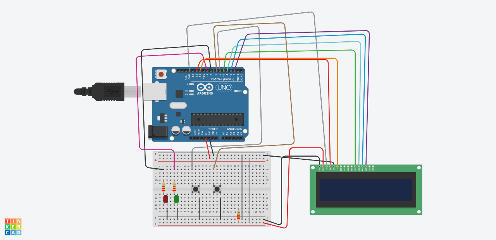

# Project 1 – Sizzling Lappi-Turing (Arduino Uno + 16x2 LCD)

An Arduino Uno circuit, designed and simulated in **Tinkercad Circuits**, that combines two push buttons (**ENTRY** and **EXIT**), two status LEDs (**green** and **red**) and a **16x2 character LCD**. The buttons are the inputs, the LEDs give instant visual feedback, and the LCD shows messages to the user. *Sizzling Lappi-Turing* is the name Tinkercad generated for the design.



---

## 1. Files in this folder

| File | Purpose |
|---|---|
| `Sizzling_Lappi-Turing.png` | Screenshot of the breadboard view (the wiring as built) |
| `schematic_drawing.pdf` | Tinkercad schematic view, generated 11/20/2026 |
| `sizzling_lappi_turing_code.ino` | Arduino sketch that runs on the Uno |
| `tools&naming.csv` | Bill of materials: component names, designators and quantities |
| `description.md` | This document |

---

## 2. Components

| Designator | Qty | Component | Role |
|---|---|---|---|
| U1 | 1 | Arduino Uno R3 | Microcontroller board |
| U2 | 1 | LCD 16 x 2 (parallel, HD44780-type) | Text display |
| SENTRY_BUTTON, SEXIT_BUTTON | 2 | Pushbutton | Entry and exit inputs |
| D1 | 1 | Green LED | Status indicator |
| D2 | 1 | Red LED | Status indicator |
| R1, R2, R3 | 3 | 220 Ω resistor | R2 limits the red LED current, R3 limits the green LED current (see the note on R1 in section 6) |
| – | 1 | Breadboard, small | Holds the LEDs, buttons, resistors and power rails |

> **Naming note:** `D1` and `D2` are the **component designators** of the LEDs (green and red). They are not Arduino pin numbers. The Arduino pins are written `D2`, `D3` and so on in section 3, and are always called "pin" or "Arduino D…" in this document.

---

## 3. Pin map (traced from the breadboard drawing)

### 3.1 Arduino Uno connections

| Arduino pin | Connected to | Wire colour in drawing |
|---|---|---|
| D2 | LCD **DB7** | purple |
| D3 | LCD **DB6** | blue |
| D4 | LCD **DB5** | light blue |
| D5 | LCD **DB4** | green |
| D6 | Button on the left of the breadboard | grey |
| D7 | Button on the right of the breadboard | brown |
| D8 | **Red LED** (through R2, 220 Ω) | black |
| D9 | **Green LED** (through R3, 220 Ω) | pink |
| D11 | LCD **E** (enable) | orange |
| D12 | LCD **RS** (register select) | red |
| 5V | Breadboard + rail | red |
| GND | Breadboard − rail and LCD **VO** | black / grey |

### 3.2 LCD (U2) pins

| LCD pin | Connected to |
|---|---|
| GND | Ground |
| VCC | 5 V |
| VO (contrast) | Ground (maximum contrast) |
| RS | Arduino D12 |
| RW | Ground (write-only mode) |
| E | Arduino D11 |
| DB0 – DB3 | Not connected (4-bit mode) |
| DB4 – DB7 | Arduino D5, D4, D3, D2 |
| LED+ / LED− | Not wired in the drawing |

### 3.3 LEDs and buttons on the breadboard

* **Red LED:** Arduino D8 → R2 (220 Ω) → LED → ground rail.
* **Green LED:** Arduino D9 → R3 (220 Ω) → LED → ground rail.
* **Each button:** one side goes to its Arduino pin (D6 or D7) and the other side goes straight to the ground rail. There are no external pull-up or pull-down resistors, so the sketch must enable the internal pull-ups with `INPUT_PULLUP`. A button then reads `LOW` while it is pressed.
* **Power rails:** the top and bottom rails are bridged by two grey jumper wires, so ground and 5 V are available on both sides of the board.

---

## 4. Firmware set-up implied by the wiring

These lines follow directly from the wiring above (the library is the standard `LiquidCrystal` library that ships with the Arduino IDE):

```cpp
#include <LiquidCrystal.h>

LiquidCrystal lcd(12, 11, 5, 4, 3, 2);   // RS, E, DB4, DB5, DB6, DB7

const int BTN_LEFT  = 6;   // button on the left of the breadboard
const int BTN_RIGHT = 7;   // button on the right of the breadboard
const int LED_RED   = 8;
const int LED_GREEN = 9;

void setup() {
  lcd.begin(16, 2);
  pinMode(BTN_LEFT,  INPUT_PULLUP);
  pinMode(BTN_RIGHT, INPUT_PULLUP);
  pinMode(LED_RED,   OUTPUT);
  pinMode(LED_GREEN, OUTPUT);
}
```

The full program is in `sizzling_lappi_turing_code.ino`.

---

## 5. How to run it

### Option A – Tinkercad simulation
1. Open [Tinkercad Circuits](https://www.tinkercad.com/circuits) and create a new circuit.
2. Place the parts from section 2 and wire them as in section 3 (or compare with `Sizzling_Lappi-Turing.png`).
3. Click **Code → Text**, paste the contents of `sizzling_lappi_turing_code.ino`, then press **Start Simulation**.
4. Click the two buttons to test the inputs. Watch the LEDs and the LCD.

### Option B – Real hardware
1. Wire the circuit as described in section 3.
2. Open `sizzling_lappi_turing_code.ino` in the Arduino IDE.
3. Select **Tools → Board → Arduino Uno** and the correct port.
4. Click **Upload**.
5. If the LCD shows blocks or nothing, turn the contrast: on a real LCD module, VO should go to the middle pin of a 10 kΩ potentiometer rather than straight to ground.

---

## 6. Observations about the drawing

* **R1:** the third 220 Ω resistor is placed on the lower right of the breadboard and is connected to the + rail at one end. I could not trace a second connection for it, and the LCD backlight pins (LED+ / LED−) are not wired. If the backlight is meant to be powered, R1 would normally sit in series between 5 V and LED+, with LED− on ground. Otherwise R1 can be removed from the design and from the bill of materials.
* **Button names:** the schematic names the buttons `SENTRY_BUTTON` and `SEXIT_BUTTON` (Tinkercad adds the leading `S` as a switch prefix, so the real names are `ENTRY_BUTTON` and `EXIT_BUTTON`). The drawing does not show which one is D6 and which is D7, so check the pin constants in the sketch.
* **Contrast on real hardware:** tying VO to ground works in Tinkercad. On a physical LCD it often gives a fully dark or fully blank screen, so use a potentiometer.

---

## 7. Summary

| Item | Value |
|---|---|
| Board | Arduino Uno R3 |
| Tool | Tinkercad Circuits |
| Inputs | 2 push buttons (D6, D7), internal pull-ups |
| Outputs | Red LED (D8), green LED (D9), 16x2 LCD in 4-bit mode (D2–D5, D11, D12) |
| Supply | 5 V from the Uno (USB) |
| Library | `LiquidCrystal` (built in) |